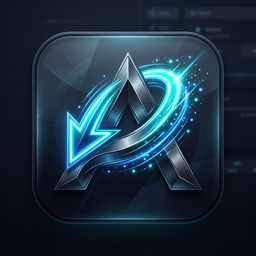

# ⚡ ASM Download Manager (ADM) for Android

  

  <b>مدير التنزيلات الاحترافي فائق السرعة لنظام أندرويد</b> 
  <b>Ultra-Fast, Segmented Download Manager for Android</b>

  
  
  

---

## 🌟 نظرة عامة | Overview

تطبيق **ASM Download Manager (ADM)** هو مدير تنزيلات متطور مصمم خصيصاً لأجهزة أندرويد ليوفر أقصى سرعة تحميل ممكنة عبر تقنية تقسيم الملفات وتعدد الاتصالات (Multi-threaded Segmented Downloading)، مع واجهة عربية حديثة ودعم كامل للعمل المستقر في الخلفية واستئناف التنزيلات غير المكتملة.

**ASM Download Manager (ADM)** is an advanced, high-performance download manager designed for Android, providing maximum download speeds through multi-connection segmentation, smart queue management, background downloading, and seamless auto-updates.

---

## ✨ المميزات الرئيسية | Key Features

* 🚀 **تسريع التحميل عبر الاتصالات المتعددة:** دعم تقسيم الملف الواحد إلى عدة اتصالات متوازية (تصل إلى 32 خيطاً) لمضاعفة سرعة التنزيل واستغلال كامل سرعة الإنترنت.
* ⏸️ **استئناف التنزيلات المنقطعة:** إمكانية إيقاف واستئناف التنزيلات في أي وقت دون فقدان البيانات المحملة مسبقاً.
* 🔋 **استقرار تام بالخلفية:** دعم خدمة العمل بالخلفية المتقدمة لضمان استمرار التنزيلات حتى عند إغلاق الشاشة أو قفل الهاتف.
* 🔔 **شريط إشعارات تفاعلي حي:** عرض سرعة التنزيل والنسبة المئوية وشريط التقدم في لوحة إشعارات أندرويد في الوقت الفعلي.
* 🎨 **تصميم عصري ودعم الوضعين (Dark & Light):** مظهر داكن أنيق مستوحى من هوية ADM ومظهر فاتح متناسق مع حفظ الإعدادات تلقائياً.
* 🔄 **تحديث تلقائي ذاتي (In-App Self-Update):** فحص التحديثات وتنزيل وتثبيت أحدث الإصدارات مباشرة من داخل التطبيق بنقرة زر واحدة.
* 📁 **تصنيف تلقائي للملفات:** فرز الملفات فورياً حسب النوع (فيديو، صوتيات، مستندات، ملفات مضغوطة، برامج).
* 📋 **التقاط الروابط الذكي:** الكشف التلقائي عن الروابط المنسوخة من الحافظة ومشاركتها مباشرة من المتصفحات والتطبيقات.

---

## 📥 التحميل والتثبيت | Download & Install

يمكنك تحميل ملف الـ APK المباشر من صفحة الإصدارات:
👉 [**تحميل أحدث إصدار من Releases**](https://github.com/Engineer-Ahmed-Said-Official/ADM-Android/releases/latest)

---

## 💖 ادعم تطوير البرنامج | Support Development

إذا أعجبك البرنامج، يمكنك دعم استمرار تطويره وإضافة المزيد من الميزات:

* **PayPal:** [paypal.me/aezr555](https://paypal.me/aezr555)
* **InstaPay:** `ahmedsaid131199@instapay`

---

## 🌐 تابعنا | Follow Us

* **الموقع الرسمي:** [www.asm-echo.com](https://www.asm-echo.com/)
* **YouTube:** [@ASM-ECHO](https://www.youtube.com/@ASM-ECHO)
* **Facebook:** [ASM0ECHO](https://www.facebook.com/ASM0ECHO)

---

## 📄 الترخيص | License

هذا المشروع مرخص تحت رخصة [MIT License](LICENSE).
